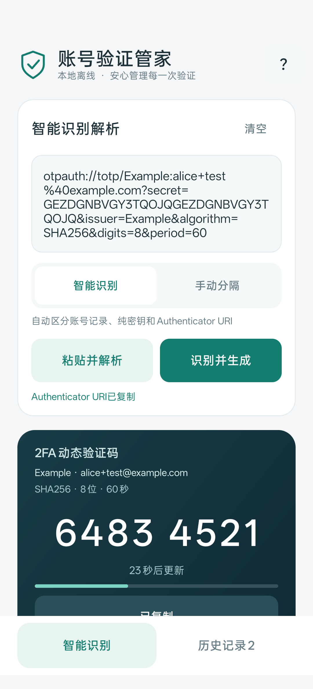

# 账号验证管家

离线拆分账号、密码和 2FA 密钥，显示实时验证码，支持一键复制和最近十条加密历史。目前提供 Windows 桌面版和 Android 手机版。

| 平台 | 下载 | 文档 |
| --- | --- | --- |
| Windows 10 / 11 | [Windows v1.5.0 便携版](https://github.com/Ayc-Gh/AccountVerificationManager/releases/tag/v1.5.0) | [Windows 使用说明](使用说明.txt) |
| Android 8.0+ | [Android v1.1.0 安装包与源码](https://github.com/Ayc-Gh/AccountVerificationManager/releases/tag/android-v1.1.0) | [Android 构建与使用说明](android/README.md) |

## Android 手机版

Android 原生应用位于 [`android/`](android/)，支持 Android 8.0 及以上，无网络权限、无需 Root。v1.1.0 新增智能识别账号记录、纯 2FA 密钥和 Authenticator URI；支持 URI 的 SHA1/SHA256/SHA512、6/8 位与实际周期，保留复制及最近 10 条历史。历史使用 Android Keystore 与 AES-256-GCM 在本机加密保存。

- [下载 APK](https://github.com/Ayc-Gh/AccountVerificationManager/releases/download/android-v1.1.0/AccountVerificationManager-android-v1.1.0.apk)
- [Android 项目说明](android/README.md) · [功能对应](android/docs/项目理解与功能对应.md) · [验证报告](android/docs/验证报告.md)
- 验证：18 组单元测试、60 项真机检查，发布版 Lint 无问题。
- Windows DPAPI 历史暂不能导入 Android；卸载会删除手机本地历史。

| 纯密钥 | Authenticator URI | 识别结果 |
| --- | --- | --- |
|  |  |  |

## Windows 桌面版

以下为 Windows v1.5.0 的智能解析功能与构建说明。

一个在 Windows 本机运行的账号信息整理与 2FA 智能解析工具。自动识别整条账号记录、纯 Base32 密钥和 Authenticator URI（`otpauth://`），生成对应的验证码并分项复制。

[下载 Windows v1.5.0](https://github.com/Ayc-Gh/AccountVerificationManager/releases/tag/v1.5.0) · [详细使用说明](./使用说明.txt)

## 使用

1. 在 [Releases](https://github.com/Ayc-Gh/AccountVerificationManager/releases) 下载 `AccountVerificationManager-v1.5.0-win-portable.zip`。
2. 解压，双击 **账号验证管家.exe**，无需安装或管理员权限。
3. 粘贴账号记录、纯密钥或 URI，点击 **识别并生成**；也可以点击 **粘贴并解析**，或按 `Ctrl+Enter`。
4. 点击字段旁的复制按钮，复制账号、密码、密钥或当前验证码。

输入示例均为虚构测试数据：

```text
demo@example.com----DemoPassword----GEZDGNBVGY3TQOJQGEZDGNBVGY3TQOJQ
demo@example.com------DemoPassword=====GEZDGNBVGY3TQOJQGEZDGNBVGY3TQOJQ
demo@example.com|||DemoPassword===GEZDGNBVGY3TQOJQGEZDGNBVGY3TQOJQ
GEZDGNBVGY3TQOJQGEZDGNBVGY3TQOJQ
otpauth://totp/Example:demo%40example.com?secret=GEZDGNBVGY3TQOJQGEZDGNBVGY3TQOJQ&issuer=Example&algorithm=SHA1&digits=6&period=30
```

## 功能

- **自动识别分隔符**：识别连续 3 个及以上标点或符号，两处的符号及长度可以不同。
- **手动分隔符**：支持单字符、多字符和文本，按填写的内容原样匹配。
- **纯密钥识别**：直接粘贴 Base32 密钥，支持大小写、分组空白与标准 `=` 填充，默认 SHA1 / 6 位 / 30 秒。
- **Authenticator URI**：解析 `otpauth://totp/...` 和 `otpauth://hotp/...`，识别服务名、账号、密钥及参数。
- **可变 TOTP 参数**：支持 SHA1、SHA256、SHA512，6/8 位数字与 URI 指定的正整数刷新周期；复制时按当前时间重新计算。
- **HOTP 计数器**：显示 URI 中指定计数器对应的验证码，只有点击 **下一个** 才会加一并加密保存，复制不递增计数器。
- **最近 10 条历史**：成功识别后自动保存，完全相同的记录会置顶，重启后仍可查看。
- **历史快捷复制**：每条记录均可单独复制账号、密码、当前验证码，或复制整组三项。
- **恢复历史记录**：点击账号名称或时间，恢复登录信息及解析模式。
- **本地加密**：历史记录使用 Windows 当前用户的 DPAPI 加密，应用不联网。
- **紧凑界面**：自动与手动模式切换、密码显示控制、验证码卡片、复制成功反馈及可收起的历史面板。

## 格式说明

自动模式从连续符号中优先识别连续重复至少 3 次的部分。例如 `pass*-----` 中，密码末尾的 `*` 会保留。没有重复部分的混合符号串按整段识别。

使用第一处和最后一处分隔符，因此密码内部的符号串可以保留。如果密码边缘的符号和分隔符相连而产生歧义，请使用手动模式并核对结果。

整条记录的最后一项既可填写 Base32 密钥，也可填写完整的 Authenticator URI。使用 URI 时保留外层账号和密码，并采用 URI 的验证码参数。

URI 识别 `secret`、`issuer`、`algorithm`、`digits`、`period`、`counter`；支持百分号编码的中文、账号与服务名。服务名优先取 `issuer` 参数，缺少时取标签前缀。不支持的算法、位数、重复参数或损坏的 URI 会明确报错。

纯密钥和 URI 没有提供账号或密码时显示“未提供”，对应复制按钮停用；不会猜测或生成这些登录信息。历史列表中无账号的密钥以短指纹区分，不直接显示密钥内容。

TOTP 需要电脑时间准确。本版本不解析二维码图片或 `otpauth-migration://` 批量迁移链接。URI 格式参照 [Authenticator Key URI Format](https://github.com/google/google-authenticator/wiki/Key-Uri-Format)，TOTP 算法参照 [RFC 6238](https://www.rfc-editor.org/rfc/rfc6238)。

一次解析一条记录。修改输入、切换模式或更改手动分隔符后，原结果会失效，重新解析后才能复制。

## 历史数据

历史文件位于：

```text
%LOCALAPPDATA%\AccountVerificationManager\history.bin
```

记录保存已提供的账号、密码、2FA 密钥、识别时间、输入类型及验证码参数，不保存验证码。通常只能在同一设备、同一 Windows 用户账户下解密，不作为跨设备备份格式。兼容 v1.4 的加密历史，保存时自动升级格式。

**清空内容**仅清除当前窗口的输入和结果；历史面板中的 **清空历史记录** 经确认后清除历史。若文件损坏或无法解密，应用会保留原文件并提示。

复制操作会写入 Windows 剪贴板，受系统剪贴板历史和同步设置影响。

## 从源码构建

环境：Windows 10 / 11，系统 .NET Framework 4.x 编译器及 PowerShell。不需要安装第三方库。

```powershell
.\build.ps1
```

输出：

```text
release\账号验证管家.exe
release\使用说明.txt
```

构建脚本同时执行解析、RFC 算法向量、智能识别、历史迁移与界面逻辑集成测试；测试使用隔离目录和虚构数据，不接触正式历史文件。

## 源码结构

| 文件 | 用途 |
| --- | --- |
| `Core.cs` | 分隔符识别、Base32 与 TOTP |
| `History.cs` | 最近 10 条记录、DPAPI 加密与持久化 |
| `Program.cs` | Windows Forms 界面与交互 |
| `Tests.cs` | 解析和验证码测试 |
| `SmartTests.cs` | 纯密钥、URI、验证码参数与异常输入测试 |
| `HistoryTests.cs` | 历史记录、安全存储与恢复测试 |
| `UiChecks.cs` | 在测试进程中实例化界面的逻辑集成测试 |
| `build.ps1` | 编译、图标生成与测试 |

## v1.5.0

- 新增智能识别：账号记录、纯 2FA 密钥和 Authenticator URI。
- 支持 URI 的服务名、账号、SHA1/SHA256/SHA512、6/8 位与自定义周期。
- 支持 HOTP 计数器及显式“下一个”操作，多窗口复制时读取最新计数器。
- 历史记录保存完整参数，兼容旧版数据；不再为纯密钥或 URI 假定密码存在。

## v1.4.0

- 应用更名为“账号验证管家”。
- 增加最近 10 条识别记录及本机加密保存。
- 增加历史恢复、分项复制、整组复制和清空历史。
- 保留自动/手动分隔符识别、当前验证码生成及优化后的桌面界面。
