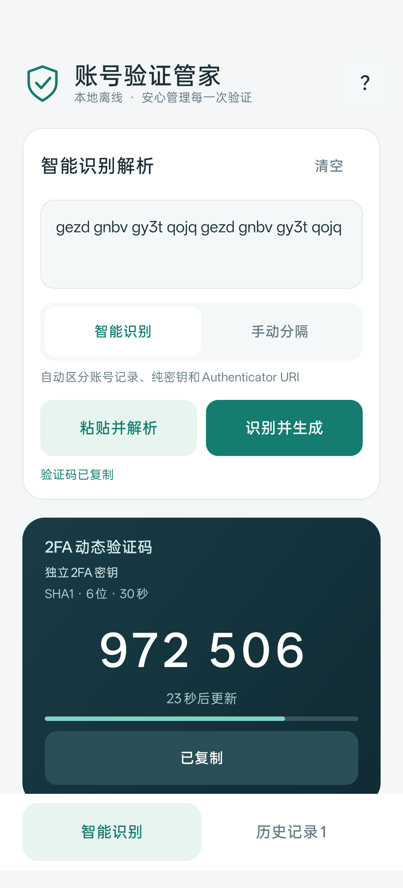

# 账号验证管家

离线拆分账号、密码和 2FA 密钥，显示实时验证码，支持一键复制和最近十条加密历史。目前提供 Windows 桌面版和 Android 手机版，两端正式版本统一为 **1.10.0**，新增登录与 CPA / sub2api 文件生成，下载见下表。

统一维护入口：[项目接手与两端差异](docs/项目接手.md)。Windows 源码在仓库根目录，Android 源码在 `android/`；两端使用同一仓库、分别保留版本号。可通过 `./verify.ps1` 一次验证两端，Android 工具链配置见 `local-build.example.psd1`。

| 平台 | 下载 | 文档 |
| --- | --- | --- |
| Windows 10 / 11 | [Windows v1.10.0 便携版](https://github.com/Ayc-Gh/AccountVerificationManager/releases/download/v1.10.0/AccountVerificationManager-v1.10.0-win-portable.zip) | [Windows 使用说明](使用说明.txt) |
| Android 8.0+ | [Android v1.10.0 APK](https://github.com/Ayc-Gh/AccountVerificationManager/releases/download/android-v1.10.0/AccountVerificationManager-android-v1.10.0.apk) | [Android 构建与使用说明](android/README.md) |

## v1.10.0 登录与 CPA / sub2api

从历史管理选择“登录并生成 CPA / sub2api”，支持 ChatGPT / OpenAI（Codex）与 Claude / Anthropic，提供历史账号自动填充、官方网页手动登录两种模式。登录结果仅在内存暂存，成功后分别生成 CPA 或 sub2api JSON。JSON 含登录令牌；原有 `.avmx` 加密历史备份功能不变。

Windows 使用专用 Edge / Chrome 窗口填写，Android 使用系统自动填充建议（需启用服务，Android 9+）。邮箱验证码、人机验证与授权在官方网页完成。解析与 2FA 仍离线运行，登录按需连接官方服务。Windows 已通过 OpenAI 真实登录与双格式文件保存；Claude 按用户要求不再核验真实登录。目标服务导入尚未验收。见 [使用与验证](docs/v1.10.0登录与文件生成.md)。

## v1.9.2 数字与单位保存期限

保存期限改为手动输入整数，旁边选择“分 / 时 / 天 / 周 / 月”；1 天为 24 小时、1 周为 7 天、1 月为 30 天。首次保存新记录时开始计时，历史管理中保存新期限时重新计时；默认可永久保留。

包括此前 1.9.0 的历史管理、多选加密导入导出，以及 1.9.1 的 Windows 管理菜单修复。Windows 4,255 项检查、Android 46 项单元测试与 142 项真机验收通过，两端加密文件双向互通通过。[使用与验证](docs/v1.9.2保存期限与发布验证.md)。

## v1.9.1 管理菜单修复

修复 Windows 历史管理菜单点击后出现 `ContextMenuStrip` 已释放异常，以及更换 2FA 时多二维码选择菜单的同类问题。菜单随所属窗口释放，选中操作在菜单点击处理结束后执行。Android 同步版本号；修复已包含于 1.9.2。[修复与验证](docs/v1.9.1管理菜单修复.md)。

## v1.9.0 历史管理与加密导入导出

首次解析可选到期时间，历史支持修改期限、删除、置顶和取消置顶。到期记录在应用运行时清理，关闭期间到期则在下次启动清理；置顶记录也会到期。重复解析保留已设置的期限和置顶状态。

支持多选历史导出为密码加密的 `.avmx` 文件，输入密码后可选择多条导入。文件包括账号、密码、2FA 密钥及 `otpauth://` 链接、名称与历史设置。两端可互导支持的 TOTP 记录，Android 仍不支持 HOTP。重复导入保留本机版本，容量超限时整批拒绝；本地仍保留最多十条记录。

这些功能已包含于 1.9.2。[使用与验证](docs/v1.9.0历史管理与加密导入导出.md)。

## v1.8.0 便捷更换 2FA

先识别或从历史恢复目标账号，点击验证码卡片右上角“更换 2FA”。可复制旧验证码，粘贴新密钥或导入二维码，预览并复制新验证码；确认服务端换绑完成后点击“保存替换”。Windows 支持上传图片，Android 支持拍照和上传。

更换保留原记录的账号、密码、名称、排序和时间。纯密钥沿用当前 TOTP 参数，URI 使用新参数且不覆盖当前账号。取消、无效输入或保存失败保留原记录；其他窗口已更新的记录会拒绝覆盖。

[使用与验证](docs/v1.8.0更换2FA.md)。

## v1.7.2 Windows 改名弹窗

改名弹窗统一使用主界面的配色、圆角输入框和按钮。当前记录独立展示，名称实时显示字数；留空时保存按钮提示“恢复默认”。支持 Enter 保存、Esc 取消，保存失败在输入框下方显示错误并保留编辑内容。

[弹窗预览与验证](docs/v1.7.2改名弹窗.md)。Android 本轮仅同步版本号。

## v1.7.1 Windows 紧凑界面

默认内容宽度从 1,300 收窄为 860 像素。解析与历史在同一窗口内切换，打开历史、恢复记录均不改变窗口宽度；历史列表按可用空间排成一列或两列。八位验证码随空间调整字号。历史页按 Esc 返回解析，解析页按 Esc 清空当前内容。

两端版本同步为 1.7.1；Android 本轮仅同步版本号。[界面验证记录](docs/v1.7.1界面验证.md)。

## v1.7.0 历史记录命名

历史列表新增“命名 / 改名”。自定义名称与历史一起加密保存，重启后保留，再次识别相同记录时保留名称；留空保存恢复默认显示。命名后保留原身份显示，不改变账号、OTP 参数、复制内容、识别时间或排序。

[1.7.0 更新与验证](docs/v1.7.0更新与验证.md)

## v1.6.0 二维码识别

Windows 新增“上传二维码”，从本机选择图片后识别；Android 新增“拍照识别二维码”和“上传二维码图片”两种入口。支持纯 Base32 密钥及标准 Authenticator URI，保留算法、位数和周期；同图多个有效二维码可选择一条。结果沿用当前验证码、复制和最近十条加密历史。图片在本机解码，不使用在线识别服务。

Android 已恢复防截图、录屏与最近任务预览保护，复制内容标记为敏感信息；原有加密历史继续保留。二维码仍遵循各平台现有 OTP 支持范围，Android 不支持 HOTP；两端均不支持 Authenticator 批量迁移二维码。

1.6.x、1.7.x 为历史本地交付，其功能已包含在 1.8.0 发行版中。详细验证见 [1.6.0 更新与验证](docs/v1.6.0更新与验证.md)。

## Android 手机版

Android 原生应用位于 [`android/`](android/)，支持 Android 8.0 及以上，无需 Root；解析和验证码离线运行，登录按需联网，系统自动填充需 Android 9.0+。v1.8.0 支持更换 2FA、历史命名、拍照与上传二维码图片，并智能识别账号记录、纯 2FA 密钥和 Authenticator URI；支持 URI 的 SHA1/SHA256/SHA512、6/8 位与实际周期，保留复制及最近 10 条历史。历史使用 Android Keystore 与 AES-256-GCM 在本机加密保存。

- [Android v1.10.0 APK](https://github.com/Ayc-Gh/AccountVerificationManager/releases/download/android-v1.10.0/AccountVerificationManager-android-v1.10.0.apk) · [发行说明](https://github.com/Ayc-Gh/AccountVerificationManager/releases/tag/android-v1.10.0)
- [Android 项目说明](android/README.md) · [功能对应](android/docs/项目理解与功能对应.md) · [验证报告](android/docs/验证报告.md)
- 1.10.0 验证：64 项单元测试、164 项真机回归检查通过，发布版 Lint 无错误。Windows 4,409 项检查与 OpenAI 真实登录、双格式导出通过；详情见 [登录与文件生成](docs/v1.10.0登录与文件生成.md)。
- 本机 DPAPI 密文不能直接复制到 Android；1.9.0 可通过密码加密导出文件互导 TOTP 记录。卸载会删除手机本地历史。

| 纯密钥 | Authenticator URI | 识别结果 |
| --- | --- | --- |
|  |  |  |

## Windows 桌面版

Windows v1.10.0 的智能解析功能与构建说明。

一个在 Windows 本机运行的账号信息整理与 2FA 智能解析工具。自动识别整条账号记录、纯 Base32 密钥和 Authenticator URI（`otpauth://`），生成对应的验证码并分项复制。

[Windows v1.10.0 便携版](https://github.com/Ayc-Gh/AccountVerificationManager/releases/download/v1.10.0/AccountVerificationManager-v1.10.0-win-portable.zip) · [详细使用说明](./使用说明.txt)

## 使用

1. 从 [Windows v1.10.0 发行页](https://github.com/Ayc-Gh/AccountVerificationManager/releases/tag/v1.10.0) 下载便携压缩包并解压。
2. 解压，双击 **账号验证管家.exe**，无需安装或管理员权限。
3. 粘贴账号记录、纯密钥或 URI，点击 **识别并生成**；也可以点击 **粘贴并解析**，或按 `Ctrl+Enter`。
4. 点击字段旁的复制按钮，复制账号、密码、密钥或当前验证码。

输入示例均为虚构测试数据：

```text
demo@example.com----DemoPassword----GEZDGNBVGY3TQOJQGEZDGNBVGY3TQOJQ
demo@example.com------DemoPassword=====GEZDGNBVGY3TQOJQGEZDGNBVGY3TQOJQ
demo@example.com|||DemoPassword===GEZDGNBVGY3TQOJQGEZDGNBVGY3TQOJQ
GEZDGNBVGY3TQOJQGEZDGNBVGY3TQOJQ
otpauth://totp/Example:demo%40example.com?secret=GEZDGNBVGY3TQOJQGEZDGNBVGY3TQOJQ&issuer=Example&algorithm=SHA1&digits=6&period=30
```

## 功能

- **二维码图片**：点击“上传二维码”选择 PNG、JPEG 等图片，本机识别后直接生成验证码；多个有效二维码可选择一条。

- **自动识别分隔符**：识别连续 3 个及以上标点或符号，两处的符号及长度可以不同。
- **手动分隔符**：支持单字符、多字符和文本，按填写的内容原样匹配。
- **纯密钥识别**：直接粘贴 Base32 密钥，支持大小写、分组空白与标准 `=` 填充，默认 SHA1 / 6 位 / 30 秒。
- **Authenticator URI**：解析 `otpauth://totp/...` 和 `otpauth://hotp/...`，识别服务名、账号、密钥及参数。
- **可变 TOTP 参数**：支持 SHA1、SHA256、SHA512，6/8 位数字与 URI 指定的正整数刷新周期；复制时按当前时间重新计算。
- **HOTP 计数器**：显示 URI 中指定计数器对应的验证码，只有点击 **下一个** 才会加一并加密保存，复制不递增计数器。
- **历史命名**：每条记录支持“命名 / 改名”，最多 40 个字符，留空可恢复默认名称。
- **最近 10 条历史**：成功识别后自动保存，完全相同的记录会置顶，重启后仍可查看。
- **历史快捷复制**：每条记录均可单独复制账号、密码、当前验证码，或复制整组三项。
- **恢复历史记录**：点击账号名称或时间，恢复登录信息及解析模式。
- **本地加密**：历史记录使用 Windows 当前用户的 DPAPI 加密。解析与验证码离线运行，登录按需联网。
- **紧凑界面**：自动与手动模式切换、密码显示控制、验证码卡片、复制成功反馈及同窗口切换的历史页。

## 格式说明

自动模式从连续符号中优先识别连续重复至少 3 次的部分。例如 `pass*-----` 中，密码末尾的 `*` 会保留。没有重复部分的混合符号串按整段识别。

使用第一处和最后一处分隔符，因此密码内部的符号串可以保留。如果密码边缘的符号和分隔符相连而产生歧义，请使用手动模式并核对结果。

整条记录的最后一项既可填写 Base32 密钥，也可填写完整的 Authenticator URI。使用 URI 时保留外层账号和密码，并采用 URI 的验证码参数。

URI 识别 `secret`、`issuer`、`algorithm`、`digits`、`period`、`counter`；支持百分号编码的中文、账号与服务名。服务名优先取 `issuer` 参数，缺少时取标签前缀。不支持的算法、位数、重复参数或损坏的 URI 会明确报错。

纯密钥和 URI 没有提供账号或密码时显示“未提供”，对应复制按钮停用；不会猜测或生成这些登录信息。历史列表中无账号的密钥以短指纹区分，不直接显示密钥内容。

TOTP 需要电脑时间准确。本版本支持二维码图片，不支持 `otpauth-migration://` 批量迁移链接。URI 格式参照 [Authenticator Key URI Format](https://github.com/google/google-authenticator/wiki/Key-Uri-Format)，TOTP 算法参照 [RFC 6238](https://www.rfc-editor.org/rfc/rfc6238)。

一次解析一条记录。修改输入、切换模式或更改手动分隔符后，原结果会失效，重新解析后才能复制。

## 历史数据

历史文件位于：

```text
%LOCALAPPDATA%\AccountVerificationManager\history.bin
```

记录保存已提供的账号、密码、2FA 密钥、识别时间、输入类型及验证码参数，不保存验证码。通常只能在同一设备、同一 Windows 用户账户下解密，不作为跨设备备份格式。兼容 v1.4 的加密历史，保存时自动升级格式。

**清空内容**仅清除当前窗口的输入和结果；历史面板中的 **清空历史记录** 经确认后清除历史和已恢复的当前记录。若文件损坏或无法解密，应用会保留原文件并提示。

复制操作会写入 Windows 剪贴板，受系统剪贴板历史和同步设置影响。

## 从源码构建

环境：Windows 10 / 11，系统 .NET Framework 4.x 编译器及 PowerShell。不需要单独安装第三方运行库。固定版本的 ZXing.Net 嵌入 EXE，源码构建使用 `third_party/zxing/` 中的程序集及许可证。

```powershell
.\build.ps1
```

输出：

```text
release\账号验证管家.exe
release\使用说明.txt
```

构建脚本同时执行解析、RFC 算法向量、智能识别、历史迁移与界面逻辑集成测试；测试使用隔离目录和虚构数据，不接触正式历史文件。

## 源码结构

| 文件 | 用途 |
| --- | --- |
| `Core.cs` | 分隔符识别、Base32 与 TOTP |
| `History.cs` | 最近 10 条记录、DPAPI 加密与持久化 |
| `Program.cs` | Windows Forms 界面与交互 |
| `Tests.cs` | 解析和验证码测试 |
| `SmartTests.cs` | 纯密钥、URI、验证码参数与异常输入测试 |
| `HistoryTests.cs` | 历史记录、安全存储与恢复测试 |
| `UiChecks.cs` | 在测试进程中实例化界面的逻辑集成测试 |
| `QrImport.cs`、`QrTests.cs` | 二维码解码、内嵌依赖与图片行为验证 |
| `build.ps1` | 编译、图标生成与测试 |

## v1.5.0

- 新增智能识别：账号记录、纯 2FA 密钥和 Authenticator URI。
- 支持 URI 的服务名、账号、SHA1/SHA256/SHA512、6/8 位与自定义周期。
- 支持 HOTP 计数器及显式“下一个”操作，多窗口复制时读取最新计数器。
- 历史记录保存完整参数，兼容旧版数据；不再为纯密钥或 URI 假定密码存在。

## v1.4.0

- 应用更名为“账号验证管家”。
- 增加最近 10 条识别记录及本机加密保存。
- 增加历史恢复、分项复制、整组复制和清空历史。
- 保留自动/手动分隔符识别、当前验证码生成及优化后的桌面界面。
