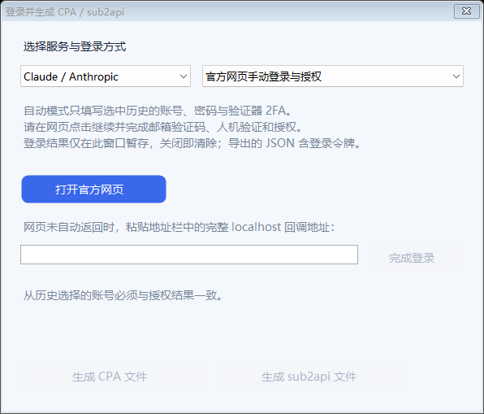

# 1.10.0 登录与 CPA / sub2api 文件

2026-11-17，Windows 与 Android 本地测试版，尚未发布 GitHub。最新公开版仍为 1.9.2。本次实现与虚构数据验证完成。Windows 已通过 OpenAI 真实账号的官方登录、动态 2FA、用户确认授权、回调及两种 JSON 文件保存；文件结构与一致性校验通过。Claude 按用户要求停止真实账号核验，保留已实现功能。实际 CPA / sub2api 服务端导入尚未验收。

## 使用

1. 解析并保存账号，或在历史中找到包含实际登录邮箱的记录。
2. 历史记录的“管理”→“登录并生成 CPA / sub2api”。
3. 选择 ChatGPT / OpenAI（Codex）或 Claude / Anthropic。
4. 选择“历史账号自动填充”或“官方网页手动登录与授权”，点击“打开官方网页”。
5. 在官方网页点击继续、完成邮箱验证码或人机验证，确认授权。自动填充模式填写账号、密码、验证器动态 2FA，不处理邮箱收件箱，也不自动确认授权。
6. 回到管家，登录成功后可分别保存 CPA 或 sub2api JSON。未自动返回时，粘贴地址栏中完整的 `http://localhost:...` 回调地址。

授权结果的邮箱须与选择的历史账号一致。账号只是用户名而非登录邮箱时，不能通过此身份校验。社交登录或 Claude 邮箱链接等流程需要在官方页面完成；网页未出现可识别字段时，可选择手动模式。

Windows 自动模式使用独立临时 Edge / Chrome 浏览器窗口，关闭登录窗口或完成登录后关闭该专用浏览器并尝试清理临时配置；手动模式打开系统默认浏览器。只向精确匹配的官方 HTTPS 页面填入所选账号，第三方社交登录页不填充。

Android 手动模式支持 API 26+；自动填充需 API 28+、官方 Chrome / Edge 以及用户启用本应用的系统自动填充服务。Chrome 还需在浏览器设置选择使用其他服务。系统展示建议，点击后重新核对记录并计算当前 TOTP。没有更改用户现有的自动填充、浏览器或其他手机设置。无法核实 HTTPS 来源、浏览器签名不符、页面字段不明或邮件验证码页面不提供对应 TOTP。页面、应用弹窗保持 `FLAG_SECURE`；外部浏览器的截图策略由浏览器控制。

## 数据与期限

原有解析、验证码、历史、二维码和 `.avmx` 仍离线运行。只有用户主动开始登录，才访问官方登录网页和授权令牌接口；新增 Android `INTERNET` 权限。

每次登录生成独立的随机 PKCE verifier 与 state，使用 S256。回调须匹配协议、localhost 主机、固定端口、路径及本次 state；拒绝重复参数、错账号、授权码重放与无效期限。官方拒绝授权的回调会终止本次流程。授权码交换禁用 HTTP 重定向，网络超时 30 秒，响应限 1 MB，不自动重试可能已经消费的一次性授权码。

登录会话最长 15 分钟；关闭窗口、选中记录被删除、到期或修改凭据，以及令牌过期，都会使登录状态失效。Android 旋转仅复用内存中的会话，Bundle 只保存选择项和文件保存状态；进程重建需要重新登录。

令牌不写入本机历史。用户显式保存的 JSON 是明文凭据文件，包含 access token、refresh token、身份和令牌期限，不包含历史中的账号密码或 2FA 密钥。JSON 与密码加密的 `.avmx` 是两个独立用途；已经导出的 JSON 不随本地记录删除或到期而删除。

## 上游格式依据

本次核对的 CLIProxyAPI 提交为 `7df56074b252384d878ec4fca840552c6fb5236e`，sub2api 为 `15871f904056f548dd874a1d069ffc6cdf777b78`。实现独立于这两个项目，不依赖运行中的代理管理后台。

- OpenAI OAuth 参数与令牌交换：[CLIProxyAPI openai_auth.go](https://github.com/router-for-me/CLIProxyAPI/blob/7df56074b252384d878ec4fca840552c6fb5236e/internal/auth/codex/openai_auth.go)。
- Claude OAuth 参数与令牌交换：[CLIProxyAPI anthropic_auth.go](https://github.com/router-for-me/CLIProxyAPI/blob/7df56074b252384d878ec4fca840552c6fb5236e/internal/auth/claude/anthropic_auth.go)。
- CPA OpenAI 文件为 `type: codex`：[CodexTokenStorage](https://github.com/router-for-me/CLIProxyAPI/blob/7df56074b252384d878ec4fca840552c6fb5236e/internal/auth/codex/token.go)。Claude 为 `type: claude`，组织字段为 `organization_uuid`：[ClaudeTokenStorage](https://github.com/router-for-me/CLIProxyAPI/blob/7df56074b252384d878ec4fca840552c6fb5236e/internal/auth/claude/token.go)。
- sub2api 使用原生 `sub2api-data`、version 1，包含 `exported_at`、`proxies`、`accounts`；账号平台分别为 `openai` / `anthropic`，类型为 `oauth`：[DataPayload / DataAccount](https://github.com/Wei-Shaw/sub2api/blob/15871f904056f548dd874a1d069ffc6cdf777b78/backend/internal/handler/admin/account_data.go)。Claude 凭据组织字段为 `org_uuid`：[TokenInfo](https://github.com/Wei-Shaw/sub2api/blob/15871f904056f548dd874a1d069ffc6cdf777b78/backend/internal/service/oauth_service.go)。
- Android 自动填充机制：[Android Developers](https://developer.android.com/identity/autofill/autofill-services)。浏览器签名核对采用微软维护的 [MSAL browser safelist](https://github.com/AzureAD/microsoft-authentication-library-for-android/blob/f750efd413425291401c47aa041bd0e684d685f8/auth_config.template.json) 中 SHA-512 证书摘要；仅用于验证官方 Chrome / Edge。

## 验证范围

测试全部使用虚构账号与虚构令牌。Windows 使用隔离历史目录；手机只安装独立 `.qa` 包，没有安装覆盖正式应用，也没有读取正式历史。Android 没有截图或录屏。

| 检查 | 本次结果 |
| --- | --- |
| Windows 核心 / 智能解析 / 二维码 / 历史 | 3,888 / 83 / 16 / 104 项通过 |
| Windows OAuth | 100 项通过，含 PKCE、回调、邮箱一致性、上游文件字段、错误令牌及本机 HTTP 回调 |
| Windows 浏览器填充脚本 | 38 项通过；密码原文、表单事件、验证码刷新与分格、用户手改、邮件验证码和域名隔离 |
| Windows UI | 180 项通过，含新登录窗口布局、两种服务与模式、无授权不能导出及记录失效后的清理 |
| Windows 专用浏览器 | 实际 Edge / Chrome 启动、CDP 连接、打开官方授权 URL、记录失效停止与清理通过；独立探针没有提交真实账号 |
| Android 单元测试 | 64 项通过，含新增 18 项 OAuth / JSON 测试 |
| Android 真机 | 164 项通过，包含两类服务的四种 JSON 实际系统文档保存路径、官方拒绝回调及关闭/删除后的状态清理 |
| Android Release Lint | 0 错误；5 条警告：1 条构建工具更新、4 条中文文本国际化提示 |
| Android 发布签名 | 原签名构建与 APK 签名校验通过 |
| 两端导出一致性 | OpenAI / Claude × CPA / sub2api 共 4 种输出，C# 与 Java 用同一虚构响应生成后 JSON 字段与值一致 |

OpenAI 真实验收在官方网页完成账号密码与动态 2FA；工作空间选择与最终授权由用户完成，管家自动交换凭据并通过原生保存窗口生成两份 JSON。检查确认两份文件的令牌、账号身份和期限一致，且包含可刷新令牌，未输出令牌内容。真实凭据文件只保存在 Git 忽略的本机私有目录，没有加入测试、文档、截图或打包。

Claude 按用户最新要求停止真实账号核验。文件结构符合上游定义不等于服务端已接受；用户实际 CPA / sub2api 版本上的导入、刷新与请求可用性尚未验收。

