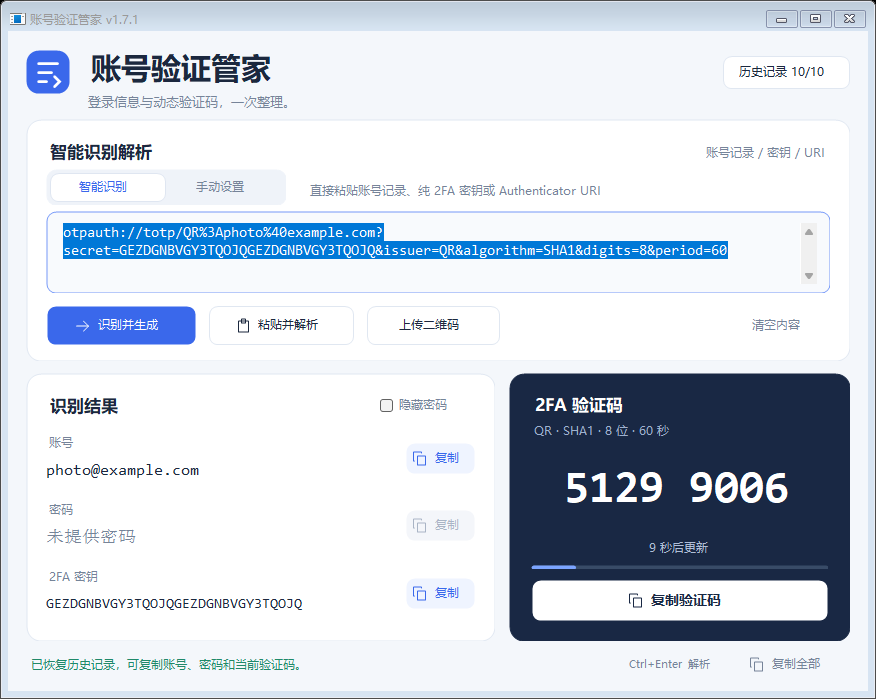
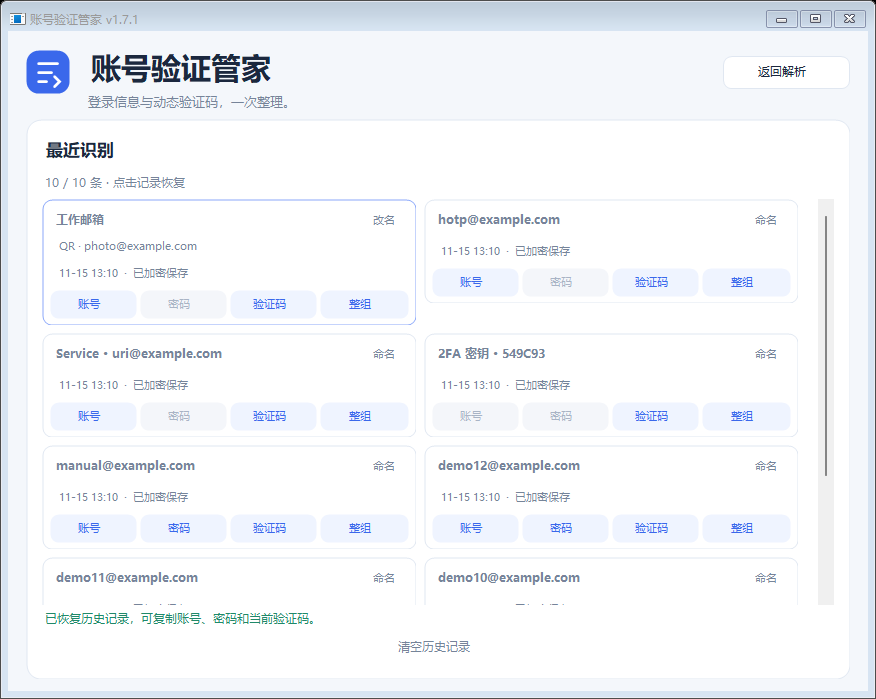

# 账号验证管家 1.7.1 紧凑界面与验证

2026-11-15，本次按 Windows 界面调整处理。默认内容宽度从 1,300 收窄为 860 像素，减少约 34%；默认内容高度为 660 像素，最小外框尺寸为 780 × 660。系统边框尺寸受 Windows 主题影响。

解析页与历史页共享同一窗口空间。点击“历史记录”切换到历史页，点击“返回解析”、按 Esc 或打开某条记录返回解析页，均不更改窗口宽度。历史列表根据可用空间排为一列或两列，超过可见范围时纵向滚动。解析页按 Esc 仍清空当前输入和结果。

窄布局检查发现八位验证码存在裁切，已通过延后到布局完成后计算字号修复。字号根据验证码位数和控件实际空间调整，并复用字体，避免在布局过程中反复修改字体造成布局异常。

## 本轮检查

| 检查 | 结果 |
| --- | --- |
| Windows 核心 | 3,858 项通过 |
| Windows 智能解析 | 83 项通过 |
| Windows 二维码 | 16 项通过 |
| Windows 加密历史 | 51 项通过 |
| Windows 界面集成 | 73 项通过 |
| Android 单元测试 | 28 组通过，0 失败、0 错误 |
| Android 发布 Lint、构建及签名 | 通过，Lint 无错误，沿用原发布证书 |

Windows 合计 4,081 项自动检查。界面检查覆盖默认启动、历史切换、命名和恢复、纯密钥、八位 URI、HOTP 递增及跨窗口刷新、二维码导入、输入失败禁用旧复制按钮，以及 Esc 在两个页面的不同作用。

窗口外框分别以 780 × 660、876 × 700、1024 × 700 检查关键复制与二维码按钮、八位验证码、历史无横向滚动，以及历史恢复不改变窗口宽度。默认尺寸预览也已检查。本轮在当前 Windows 显示配置下验证，没有逐一覆盖所有 DPI、字体缩放和多显示器组合。

实际桌面点击使用独立测试副本及 `.local/ui-compact/qa-history.bin`，只输入虚构账号与公开 RFC 测试密钥。已检查普通记录识别、密钥复制后粘贴解析、历史页与解析页切换、重启后不主动展示凭据、历史保留、命名弹窗、中文名称保存、命名后显示原账号及恢复原凭据。二维码文件选择器显示正常；自动化工具未能完成选定文件后的点击流程，后续识别逻辑由二维码解码和导入集成检查覆盖。未读写正式用户历史。

Android 本轮仅同步版本号，重新运行上述构建检查，没有重复 1.7.0 的 88 项真机验收。两端可见版本为 1.7.1，Windows 程序集为 1.7.1.0，Android versionCode 为 10701。

## 界面预览

以下为集成检查生成的虚构数据预览。

## 本地交付

- `dist/AccountVerificationManager-v1.7.1-win-portable.zip`
- `dist/AccountVerificationManager-android-v1.7.1.apk`
- `dist/AccountVerificationManager-v1.7.1-source.zip`
- `dist/SHA256SUMS-v1.7.1.txt`

构建日志保存在 `.local/verification/`。当前为本地交付，未提交、推送或发布 GitHub Release。
