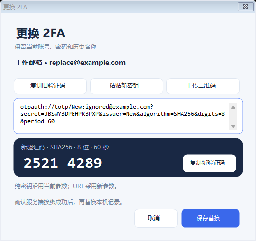

# 1.8.0 便捷更换 2FA

2026-11-16，两端新增“更换 2FA”。先识别账号，或从历史恢复目标记录，再点击验证码卡片右上角的“更换 2FA”。

1. 需要旧验证码时，点击“复制旧验证码”。
2. 粘贴新 Base32 密钥或 Authenticator URI；Windows 可上传二维码图片，Android 可拍照或上传。
3. 查看新验证码及参数，需要时复制新验证码完成服务端验证。
4. 确认服务端换绑成功后，点击“保存替换”，更新本机原记录。

此入口更新本机记录，服务端换绑由用户在对应服务中完成。二维码里的账号不会覆盖当前账号。纯密钥沿用原 TOTP 的算法、位数、周期及发行方；URI 采用新 OTP 参数。Windows HOTP 更换需提供包含新 counter 的完整 URI；Android 继续拒绝 HOTP。

## 保存规则

保存保留原账号、密码、历史名称、ID、识别时间及列表位置，不额外占一条历史。预览与复制不会写入记录。取消、无效输入和写入失败保留原记录；相同结果已存在于另一条历史时提示冲突，避免隐式合并。

提交前在锁或串行存储队列内重读历史，拒绝覆盖已删除或 OTP 已更新的记录，包括 Windows HOTP 计数器已改变的情况。另一个窗口只修改名称时，使用最新名称。损坏历史不会被更换操作覆盖。

Android 更换草稿和预览凭据只在内存保留，配置变化后恢复；新弹窗继续应用 FLAG_SECURE，复制继续标记为敏感信息。没有操作正式手机应用或其他模块设置。

Android 为保留新 URI 的自定义参数，支持账号记录末项 URI；带参数的记录在恢复、复制和重新识别后保持一致。存储仍写 v3、读取 v1/v2/v3；更换后的带自定义参数记录请使用 1.8.0 或后续版本。

## 本轮验证

| 检查 | 结果 |
| --- | --- |
| Windows 核心 | 3,858 项通过 |
| Windows 智能解析 / 二维码 | 83 / 16 项通过 |
| Windows 历史 | 67 项通过 |
| Windows 界面集成 | 99 项通过 |
| Android 单元测试 | 34 组通过，0 失败、0 错误 |
| Android 真机回归 | 107 项通过，OPPO PHY110 / API 37，独立 QA 包 |
| Android 发布 Lint / 签名构建 | 通过，Lint 无错误，使用原发布证书 |

Windows 共 4,123 项检查，包含更换保留字段、八位参数、原位持久化、并发改名、过期窗口、HOTP 计数器冲突、无效输入、重复冲突、损坏文件与取消行为，以及 780、876、1024 像素外框宽度下的新入口。

Android 本轮重新运行完整真机回归，覆盖新旧验证码复制、敏感标记、粘贴新密钥、八位预览、取消、二维码上传回填、配置重建恢复草稿、保存后主界面刷新、加密重载及重新识别、拍照入口取消。原有拍照成功导入、二维码解码和窗口标记检查也再次通过。使用虚构账号和公开测试密钥，未截图受保护的手机界面。

Windows 预览由集成检查生成；本轮没有额外人工逐点验收 Windows 文件选择器。日志在 `.local/verification/windows-v1.8.0-build.log`、`android-v1.8.0-build.log` 和 `device-tests-v1.8.0.log`。

两端版本为 1.8.0；Windows 程序集 1.8.0.0，Android versionCode 10800。Windows 新 EXE 位于 `release/v1.8.0/`，`dist/` 提供两端安装包、源码及 SHA-256 清单。发行标签分别为 [Windows v1.8.0](https://github.com/Ayc-Gh/AccountVerificationManager/releases/tag/v1.8.0) 和 [Android v1.8.0](https://github.com/Ayc-Gh/AccountVerificationManager/releases/tag/android-v1.8.0)，安装包、源码与 SHA-256 清单作为发行附件提供。
