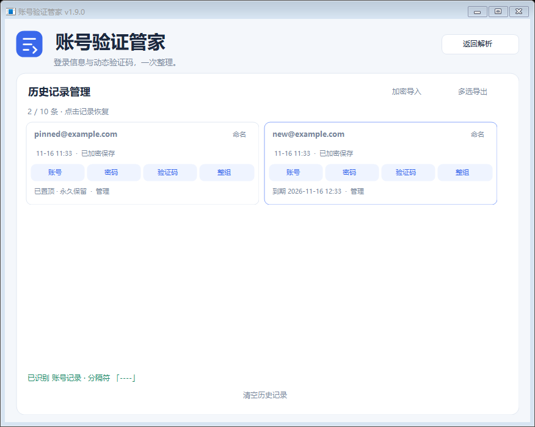
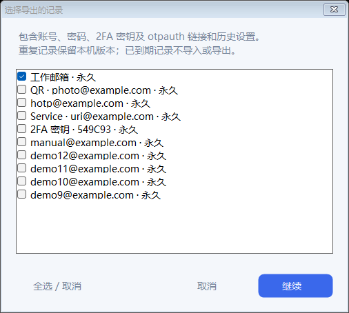

# 1.9.0 历史管理与加密导入导出

后续说明：本页保留当时的本地验收记录，功能已并入 1.9.2；当前保存期限界面与发布验证见 [1.9.2](v1.9.2保存期限与发布验证.md)。

Windows 与 Android 本地版本统一为 1.9.0。新增首次解析到期设置、历史期限管理、单条删除、置顶，以及多选密码加密文件导入导出。本轮是本地交付，尚未发布 GitHub Release。

## 到期与历史管理

解析前点击“保存期限”，可选择本地日期和时间；默认永久保留。这个选项只用于首次保存新记录，重复解析保留记录原有的名称、到期时间和置顶状态。历史中点击“管理”可以修改或取消到期时间、删除记录、置顶或取消置顶。

期限按 UTC 时刻保存，界面使用本地时间。进程运行时自动检查并清理到期记录，关闭应用期间到期则在下次启动清理；不依赖系统精确闹钟。置顶记录也会到期。到期或删除后清除已恢复的当前账号结果、输入及相关更换草稿，复制操作重新检查记录是否有效。已复制到外部剪贴板的内容不受本机历史删除控制。

容量保持十条，置顶记录排在前面并优先保留。重复识别在所属分组内前移。十条全部置顶时拒绝保存新记录，提示先删除或取消置顶。改名、更换 2FA、HOTP 递增与期限修改均保留其他元数据。并发修改前重读磁盘，不能用过期弹窗恢复已删除或到期记录。

## 多选加密导出

历史页点击“多选导出”，勾选需要的记录，支持全选/取消全选。设置并重复输入文件密码，选择保存位置，生成 `.avmx` 文件。Windows 使用保存文件窗口，Android 使用系统文件选择器。

文件包含账号、密码、2FA 密钥及 `otpauth://` 链接、验证码算法/位数/周期、历史名称、识别时间、解析模式、期限和置顶状态；不保存当前验证码。账号和密码不会在多选列表中额外展开，文件密码输入隐藏并禁止持久化。用户所指的“链接”为 2FA 验证链接，不是账号网站地址。

导出文件是独立副本，源记录删除不会删除此前导出的文件。文件密码不保存，遗忘后不能解密该文件。

## 加密导入

点击“加密导入”，选择 `.avmx` 文件并输入文件密码。校验和解密成功后，勾选要导入的记录。已到期记录不出现在可选列表中；选择后再次检查到期时间。导入保留记录原期限，不重新开始计时。

完全相同的记录保留本机内容和设置，新记录使用新的本机 ID。容量不足时整批拒绝，不覆盖或挤掉现有记录；可以减少选择或先删除部分历史。错误密码、文件篡改、损坏内容、容量超限及写入失败均不能造成部分导入。

两端使用同一文件格式，可以互导各自支持的 TOTP 记录。Windows 导出的 HOTP 文件不能导入 Android，Android 继续明确拒绝 HOTP。没有增加云同步或批量迁移 URI 支持。

## 存储与文件格式

本机历史写入 v4，到期时间和置顶随历史一起加密。用户不要求旧数据兼容；已有 v1/v2/v3 读取逻辑仍保留，旧记录缺省为永久保留、未置顶。保存后的记录请继续使用 1.9.0 或后续版本。

导出文件标识为 `AVMX0001`，使用随机 16 字节 salt、16 字节 IV、PBKDF2-HMAC-SHA256 210000 次派生 64 字节密钥，前后各 32 字节分别用于 AES-256-CBC 和 HMAC-SHA256。MAC 覆盖文件标识、salt、IV 及密文，验证通过后才解密；文件上限 2 MB。两端使用同一 UTF-8 密码编码、字段顺序与大端整数布局，已用中文及 emoji 密码验证双向互通。内部载荷为带长度的字段编码，不依赖账号文本中的分隔符拆解，因此保留密码中的空格和符号。

历史依旧使用 Windows DPAPI 或 Android Keystore/AES-GCM。正式 Android 包名、原签名、防截图及敏感剪贴板标记保持。新期限、选择和密码弹窗也应用安全标记。

## 验证与交付

自动检查覆盖到期边界、重启读取、置顶容量、并发元数据保存、重复识别、删除、过期草稿、损坏文件、密码错误、密文篡改、双向互通和导入原子性。Windows 窄窗口及新增弹窗使用虚构账号进行布局检查。Android 使用独立 QA 包，未操作正式应用数据或手机其他模块设置。

| 检查 | 实际结果 |
| --- | --- |
| Windows 核心 / 智能解析 / 二维码 | 3858 / 83 / 16 项通过 |
| Windows 历史 / 界面集成 | 98 / 112 项通过，合计 4167 项 |
| Android 单元测试 | 42 组，0 失败、0 错误 |
| Android 真机回归 | 128 项通过，独立 QA 包 |
| 跨端文件互通 | C# 导出 → Java 解密/重导出 → C# 解密通过，中文与 emoji 密码 |
| Android Lint | 0 错误、3 条既有警告（工具版本与文本国际化） |
| 发布构建和签名 | 两端构建通过，Android 沿用原发布证书 |

真机检查覆盖系统文件接口的创建、加密写入、打开、解密选择、导入与加密重载，使用测试文件提供方返回的 URI。Windows 文件加解密及选择/密码弹窗通过自动检查，本轮未额外人工逐点操作 Windows 系统文件选择器。没有截图受保护的手机界面。

本机安装包位于 `dist/`，包含 Windows 便携 ZIP、Android APK、源码 ZIP 和 SHA-256 清单。Windows 程序集为 1.9.0.0，Android versionCode 为 10900。验证日志保存在 Git 忽略的 `.local/verification/`。
