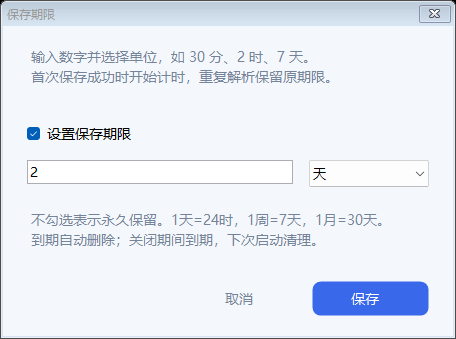

# 1.9.2 保存期限与发布验证

2026-11-16。Windows 与 Android 同步为 1.9.2，Android versionCode 为 10902。发行标签为 [Windows v1.9.2](https://github.com/Ayc-Gh/AccountVerificationManager/releases/tag/v1.9.2) 与 [Android v1.9.2](https://github.com/Ayc-Gh/AccountVerificationManager/releases/tag/android-v1.9.2)。1.9.0 / 1.9.1 的历史管理、加密多选导入导出和菜单修复一并包含在本次发行中。

## 保存期限

在“保存期限”或历史记录的“管理到期时间”中输入整数，旁边选择分、时、天、周或月。不勾选表示永久保留。接受 1 至 999999 的整数；空值、0、负数、小数、非法字符及日期溢出会提示修改。

单位为固定时长：1 天 = 24 小时、1 周 = 7 天、1 月 = 30 天，界面有明确说明。首次保存新记录时才计算实际到期时间，不消耗设置后等待解析的时间；重复解析保留原期限。历史管理会显示现有到期时间，保存新期限时从修改时重新计时。取消不改变设置，保存失败保留可编辑内容。

两端使用 UTC 到期时刻并以本地时间显示。期限选择只在内存中保留，Android 旋转后保留已选择的数字与单位；成功保存后恢复永久保留默认值。历史与加密导出格式不变，导入不会重新延长期限。

## 完整验证

| 检查 | 结果 |
| --- | --- |
| Windows 核心、TOTP、Base32、期限计算 | 3,888 项通过 |
| Windows 智能解析 | 83 项通过 |
| Windows 二维码 | 16 项通过 |
| Windows 加密历史、期限边界与文件传输 | 104 项通过 |
| Windows 界面与真实菜单点击 | 164 项通过 |
| Windows 合计 | 4,255 项通过 |
| Android 单元测试 | 46 项，无失败或错误 |
| Android 独立 QA 包真机验收 | 142 项通过 |
| Android 发布 Lint | 0 错误、4 条警告（1 条工具版本提示、3 条文本国际化提示） |
| APK 签名 | 验证通过，与既有正式签名一致 |
| C# → Java → C# 密码加密文件互通 | 解密、重加密及字段核对通过 |

期限检查覆盖五种单位、月跨闰年二月、最大数字、日期溢出、空值/0/负数/小数、首次保存起算、重复解析保留旧期限、置顶到期、到期前后边界及重启后删除。界面检查覆盖相邻控件布局、编辑/取消、永久保留、写入失败重试、菜单重复打开及删除确认。Android 实际点击受保护的单位选择弹窗，保留屏幕捕获保护及点击辅助功能事件。

真机完整重跑覆盖 Keystore 持久化、损坏历史保护、解析、复制、二维码上传/拍照、历史命名、更换 2FA、旋转、期限、到期草稿失效，以及系统文档选择器的加密导出/导入流程。最初一轮因手机锁屏导致剪贴板不可读而中断；用户解锁后重跑通过。测试只使用独立 QA 包及虚构数据，没有操作正式应用的历史。

构建入口为 `build.ps1 -OutputDirectory release\v1.9.2` 与 `android/build.ps1 -Offline -DeviceTests`（指定本机 JDK/SDK）；日志保存在 Git 忽略的 `.local/verification/`。发行附件包含 Windows EXE/便携 ZIP、原签名 Android APK、源码 ZIP 与 SHA-256 清单，源码排除历史、凭据、签名材料、机器配置和测试临时文件。发布后重新下载附件核对 SHA-256。

## 升级

Windows 退出旧版后运行新版；Android 使用原签名 APK 覆盖安装。现有历史保留。到期清理在应用运行时或下次启动执行，关闭期间不依赖系统后台闹钟。Android 仍不支持 HOTP，跨端导入只接收支持的 TOTP 记录。
